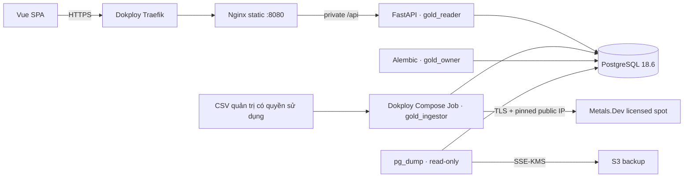

# Kiến trúc

Frontend chỉ build với Vite 8.3.6, production là Nginx non-root. Không React, Next.js, RSC, SSR hay dev server public. UI cùng origin, không mở CORS. Mọi tiền/ratio tài chính được tính ở Python với Decimal, API serialize thành chuỗi; trình duyệt chỉ định dạng và vẽ chart.

`domain` không phụ thuộc FastAPI/DB; `providers` trả Observation đã xác minh đơn vị; `ingestion` kiểm tra quyền, chất lượng và idempotency; `repositories` lấy dữ liệu; `api` đọc hoặc tính. Không public write endpoint, URL fetch endpoint hay shell endpoint.

Schema gồm `data_sources`, `gold_products`, ba bảng snapshot, `daily_reference_prices`, `ingestion_runs`. Catalog chỉ chứa metadata. Snapshot lưu UTC, provider timestamp, fetched_at, business_date Việt Nam, hash SHA-256, đơn vị, reference_type và quality. Giữ product_code/vùng/provider ở catalog và FK; không gộp vàng miếng 1 lượng với 1 chỉ hoặc vàng nhẫn.

Snapshot append-only bằng ORM hooks và trigger PostgreSQL; DB reader không có INSERT/UPDATE/DELETE. Unique source/product/timestamp chống nhập lặp; hash khác ở cùng khóa bị từ chối và rollback, không ghi đè. Ingestion advisory transaction lock tuần tự hóa writers; không chạy scheduler trong API replica. Biến động ask/bid/spot/FX vượt 20% so với observation hợp lệ trước bị quarantine, không vào daily reference.

Daily reference: snapshot cuối cùng trước/đúng 18:00 Asia/Ho_Chi_Minh, trong cửa sổ 120 phút, cùng business_date. Không lấy giá ngày trước. Spot/FX giữ riêng nguồn; reference FX cố định `reference_mid`, VND cho 1 USD. Premium là daily; nếu chênh timestamp >30 phút gắn `indicative_daily`. Không công bố premium khi thiếu spot, FX hay quote 9999.

Networks: database và application `internal`; API không có egress/public port. Worker có network outbound để API hợp lệ hoạt động. Frontend là service duy nhất nhận ingress, không có secret DB. Network isolation không thay thế host egress firewall: worker được giới hạn host ở code và phải bổ sung firewall/proxy outbound trong môi trường có yêu cầu chống RCE mạnh hơn.

Không Redis/Kafka/Kubernetes. Không auth public vì MVP không lưu tài khoản/PII; admin chỉ qua CLI nội bộ. Giới hạn frontend 10r/s + burst, backend per-peer 120/phút, body 16KiB, dải history 366 ngày. Backend dùng 1 worker để limiter process-local có semantics rõ; tăng replicas phải đặt limiter tại ingress.
